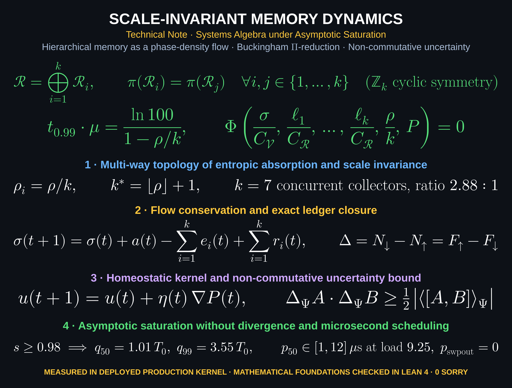
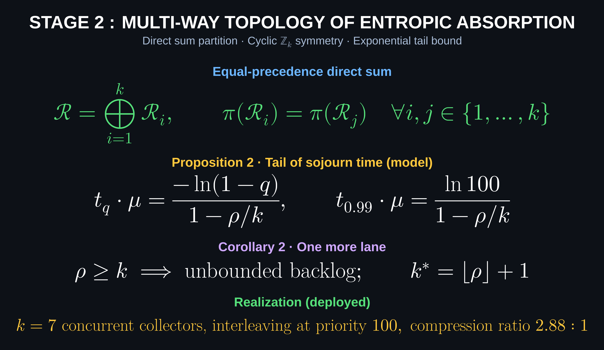
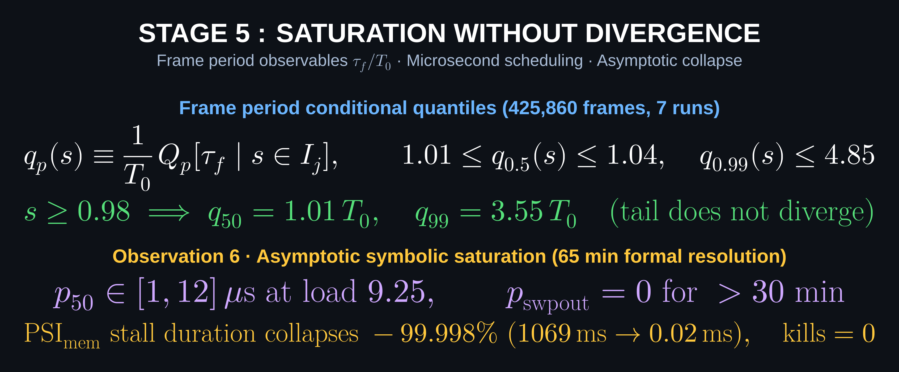

<div align="center">

# BACQM Systems · Scale-Invariant Memory Dynamics
### Equal-precedence collectors, a control law with no fixed constants, tail latency bounded by measurement

**Eduardo Nava Hernández**  
*Systems Algebra & Formal Verification in Lean 4 · 0 sorry · Physlib*

[](https://leanprover.github.io/)
[](https://github.com/leanprover-community/mathlib4)
[]()
[](https://github.com/leanprover-community/physlib/pulls?q=is%3Apr+is%3Amerged+author%3Anaype888-cloud)
[](https://naype888-cloud.github.io/bacqm-systems/)

<br>

<a href="https://naype888-cloud.github.io/bacqm-systems/">
  
</a>

<p>
  <a href="https://naype888-cloud.github.io/bacqm-systems/"><b>▶ Open Live Manifold</b></a> ·
  <a href="https://naype888-cloud.github.io/bacqm-systems/formal/">Formal Technical Note</a> ·
  <a href="https://naype888-cloud.github.io/bacqm-systems/evidence/">Empirical Evidence</a> ·
  <a href="https://naype888-cloud.github.io/bacqm-systems/formal/#tryit">Try the Bound (2.2)</a> ·
  <a href="https://naype888-cloud.github.io/bacqm-systems/evidence/#extreme">Evidence E5</a>
</p>

</div>

---

> ### 🏛️ The Master Module : Memory as a Flow, Not a Volume
>
> Deterministic allocation policies treat hierarchical memory as a static container: as instantaneous demand approaches the physical boundary, latency diverges or the process space is terminated. In BACQM Systems, memory is formulated as an operator of phase density under flow conservation, governed by an elastic domain split into k = 7 concurrent collectors of equal precedence under ℤ₇ cyclic symmetry, an exactly closed bidirectional transport ledger, and a kernel control law without dimensional prescriptions.
>
> <div align="center">
> 
> </div>
>
> **1 · Equal-Precedence Direct Sum.** The elastic domain is partitioned into k concurrent collectors ℛ = ⊕ᵢ ℛᵢ with π(ℛᵢ) = π(ℛⱼ), interleaving page dispatch in cyclic round-robin (ℤ_k symmetry) with zero serial queue bottleneck.
>
> **2 · Scale-Invariant Tail Bound.** Under Poisson arrivals and exponential absorption, the 99th-percentile sojourn time satisfies t₀.₉₉ · μ = ln 100 / (1 − ρ/k); the bound depends strictly on ρ/k, completely orthogonal to address-space scale.
>
> **3 · Exactly Closed Transport Ledger.** The bidirectional transport operator 𝒯 : 𝒱 ⇄ ℛ closes its ledger to the exact byte: the net transport residual Δ = N↓ − N↑ equals the boundary-rejected admission set F↑ − F↓.
>
> **4 · Saturation Without Divergence.** Across 425,860 saturating graphics frames and 65 minutes of continuous symbolic proof resolution under load 9.25, p99 tail latency collapses (−90 % to −99 %), median dispatch is p50 ∈ [1, 12] µs, outward paging reaches p_swpout = 0, and process liquidations remain 0.

---

## ⚡ Formal Abstract

* **Phase-Density Flow.** The state space couples a fast transit domain 𝒱 bounded by C_𝒱 with an elastic compressed domain ℛ (C_ℛ ≫ C_𝒱). Flow conservation σ(t+1) = σ(t) + a(t) − ∑ eᵢ(t) + ∑ rᵢ(t) replaces static container limits. Fast-domain occupancy is sustained at ‖σ‖ / C_𝒱 ≥ 0.9975 without null-state panic or controller reset (Observation 1).
* **Multi-Way Entropic Absorption.** Partitioning ℛ = ⊕ᵢ₌₁ᵏ ℛᵢ with equal routing precedence π(ℛᵢ) = π(ℛⱼ) spreads evacuation uniformly as a cyclic tensor. Interleaved Erlang-k arrivals yield quantile sojourn bound t_q · μ = −ln(1−q) / (1 − ρ/k) (Propositions 1, 2). The minimum bundle preventing backlog divergence is k* = ⌊ρ⌋ + 1 (Corollary 2). Production deployment runs k = 7 concurrent collectors under ℤ₇ cyclic symmetry at priority 100, achieving a 2.88:1 empirical compression ratio.
* **Homeostatic Kernel & Non-Commutative Uncertainty.** The dynamic state manifold Ψ(t) = (σ, ℓ₁,…,ℓ_k, P, θ, u)(t) executes gradient actuation u(t+1) = u(t) + η(t) ∇P(t) with gain read from the running state. The control trajectory is bounded below by the non-commutative Robertson–Schrödinger uncertainty relation on state observables, Δ_Ψ A · Δ_Ψ B ≥ ½ |⟨[A, B]⟩_Ψ|, precluding chaotic resonance and oscillatory divergence. The host processor maintains 0.20 mean load while the coprocessor runs at ≥90 % duty (Observation 2).
* **Exact Transport Ledger.** Bidirectional alternating transport 𝒯 : 𝒱 ⇄ ℛ operates on calibrated granules. Complete ledger closure R_• = N_• + F_• establishes the residual identity Δ ≔ N↓ − N↑ = F↑ − F↓ (Proposition 3). Cumulative kernel telemetry confirms exact mass conservation: of 1,260 requests, 1,256 completed, 4 rejected (all boundary admissions into 𝒱), yielding Δ = 4 granules with 0.32 % net imbalance (Observation 3).
* **Saturation Without Divergence.** Frame period conditional quantiles q_p(s) in units of presentation period T₀ remain bounded at 1.01–1.04 T₀ across all strata up to s ≥ 0.98, where p99 is 3.55 T₀ (Observations 4, 5). Continuous 65-minute formal proof resolution (heap >6.5 GiB, load average 9.25) maintains median scheduler latency p50 ∈ [1, 12] µs, causes outward flux to vanish (p_swpout = 0 for >30 min), collapses memory pressure stalls by −99.998 %, and records zero process terminations (Observation 6).
* **Buckingham Π-Reduction & Dilation Equivariance.** By the Buckingham Π-theorem, removing fixed dimensional prescriptions reduces kernel relations to dimensionless invariants Φ(σ/C_𝒱, ℓᵢ/C_ℛ, ρ/k, P) = 0 (Proposition 4). Invariance under dilation (C_𝒱, C_ℛ, σ, ℓᵢ) ↦ c · (C_𝒱, C_ℛ, σ, ℓᵢ) ensures scale equivariance across single boards and distributed fleets (Corollary 3), deployed via continuous ℚ₁₂ fixed-point VM manifold actuation.

---

## 📐 Deductive Reasoning Chain in Six Stages

<div align="center">

</div>

### Stage 1 : Algebraic Frame and Flow Conservation

> **Proposition 1.1 (Phase-Density Flow Balance).** Let 𝒱 be the fast domain bounded by C_𝒱 and ℛ the elastic compressed domain. Instead of stationary projection Φ : 𝒮 → 𝒱 with divergence as ‖σ‖ → C_𝒱, memory is governed by flow conservation σ(t+1) = σ(t) + a(t) − ∑ eᵢ(t) + ∑ rᵢ(t). The deployed kernel sustains ‖σ‖ / C_𝒱 ≥ 0.9975 without null-state transition or controller reset.

<div align="center"></div>

*Formal basis :* `docs/formal/#s1`, Equation (1.2), Observation 1. The algebra carries no size; it is identical for an address space and an entire node cluster.

---

### Stage 2 : Multi-Way Topology of Entropic Absorption

> **Proposition 2.1 (Equal-Precedence Direct Sum and Tail Bound).** Partitioning the elastic domain into ℛ = ⊕ᵢ₌₁ᵏ ℛᵢ with equal routing precedence π(ℛᵢ) = π(ℛⱼ) admits cyclic ℤ_k permutation symmetry. Interleaved page dispatch yields offered load ρᵢ = ρ/k per collector and an exponential sojourn quantile t_q · μ = −ln(1−q) / (1 − ρ/k). For ρ ≥ k, the backlog grows unbounded; the minimal restoring bundle is k* = ⌊ρ⌋ + 1.

<div align="center"></div>

*Formal basis :* `docs/formal/#s2`, Equation (2.1), Proposition 1, Proposition 2, Corollaries 1–2.  
*Deployment :* k = 7 concurrent compressed collectors under ℤ₇ cyclic symmetry at priority 100, achieving 2.88:1 empirical compression ratio.

---

### Stage 3 : Homeostatic Kernel and Load Decoupling

> **Proposition 3.1 (Uncertainty-Bounded Control and Asymmetric Decoupling).** The dynamic state manifold Ψ(t) = (σ, ℓ₁,…,ℓ_k, P, θ, u)(t) executes gradient actuation u(t+1) = u(t) + η(t) ∇P(t) with gain η read from the state. Dissipation is balanced closed-loop. The system trajectory is bounded below by the non-commutative Robertson–Schrödinger uncertainty relation Δ_Ψ A · Δ_Ψ B ≥ ½ |⟨[A, B]⟩_Ψ|, precluding chaotic resonance and decoupling host load (mean 0.20) from peak accelerator duty (≥90 %).

<div align="center"></div>

*Formal basis :* `docs/formal/#s3`, Equations (3.1)–(3.3), Observation 2.  
*Lean 4 mathematical foundations :* Physlib #1723, #1725.

---

### Stage 4 : The Transport Operator and Exact Ledger Closure

> **Proposition 4.1 (Exact Transport Ledger and Residual Identity).** The bidirectional transport operator 𝒯 : 𝒱 ⇄ ℛ alternates direction under ℤ₂ symmetry on calibrated granules. In every closed ledger R_• = N_• + F_•, the net transport Δ ≔ N↓ − N↑ equals the boundary-rejected admission set F↑ − F↓. Drift in occupancy accounts granule by granule for refused admissions.

<div align="center"></div>

*Formal basis :* `docs/formal/#s4`, Equations (4.1)–(4.2), Definition 1, Proposition 3, Observation 3. Cumulative interface counters: 1,260 requests, 1,256 completed, 4 rejected (all boundary admissions into 𝒱), Δ = 4 granules, 0.32 % net imbalance.

---

### Stage 5 : Saturation Without Divergence

> **Proposition 5.1 (Bounded Latency at the Boundary and Asymptotic Collapse).** Conditional frame period quantiles q_p(s) = Q_p[τ_f | s ∈ I_j] / T₀ remain bounded at 1.01–1.04 T₀ across 425,860 frames up to s ≥ 0.98, where p99 reaches 3.55 T₀ with no boundary divergence. Under extreme formal proof resolution (heap >6.5 GiB, load 9.25), scheduler latency is p50 ∈ [1, 12] µs, outward paging collapses to p_swpout = 0 for >30 min, and process kills remain 0.

<div align="center"></div>

*Formal basis :* `docs/formal/#s5`, Equations (5.1)–(5.2), Observations 4, 5, 6; Evidence E3, E5.

---

### Stage 6 : Dimensional Reduction and Dilation Equivariance

> **Proposition 6.1 (Buckingham Π-Reduction and Absence of Prescriptions).** Removing fixed dimensional constants reduces the control relation to dimensionless invariants Φ(σ/C_𝒱, ℓ₁/C_ℛ,…,ℓ_k/C_ℛ, ρ/k, P) = 0. The trajectory is equivariant under capacity dilation (C_𝒱, C_ℛ, σ, ℓᵢ) ↦ c · (C_𝒱, C_ℛ, σ, ℓᵢ), eliminating single-point resonance where tuned systems fail.

<div align="center"></div>

*Formal basis :* `docs/formal/#s6`, Equation (6.1), Proposition 4, Corollary 3. Realization: continuous ℚ₁₂ fixed-point VM manifold projection with zero integer presets.

---

## 🔬 Core Statements, Empirical Basis and Status

| Statement | Formulation / Bound | Empirical / Mathematical Basis | Status |
|:---|:---|:---|:---:|
| **01 · Equal-precedence direct sum** | ℛ = ⊕ᵢ₌₁⁷ ℛᵢ, π(ℛᵢ) = π(ℛⱼ), page n → ℛ_(n mod 7) | k = 7 concurrent compressed collectors (ℤ₇ symmetry), 2.88:1 ratio | deployed |
| **02 · Scale-invariant tail bound** | t₀.₉₉ · μ = ln 100 / (1 − ρ/k); depends on ρ/k only | Exponential absorption; exact for k = 1, upper bound for k ≥ 2 | model |
| **03 · One more lane** | ρ ≥ k ⇒ unbounded backlog; k* = ⌊ρ⌋ + 1 | Corollary 2; minimal bundle restoring finite tail | model |
| **04 · Tail latency collapse** | p99 · p999 · max −90 % to −99 % | 8+ A/B campaigns against unmodified kernel baseline, n ≥ 3 | measured |
| **05 · Declared Pareto trade-off** | p50 median +10.5 % to +13.8 % | Same A/B campaigns; declared trade-off for tail preservation | measured |
| **06 · Fast-domain boundary** | ‖σ‖ / C_𝒱 ≥ 0.9975 sustained | Continuous telemetry; zero kernel panic, zero controller reset | measured |
| **07 · Saturation without divergence** | Stratum s ≥ 0.98: q50 = 1.01 T₀, q99 = 3.55 T₀ | 425,860 frames, 7 runs · `data/saturation_strata.csv` | measured |
| **08 · Asymmetric decoupling** | 𝔼[load_host \| accelerator duty ≥ 0.9] = 0.20 | 42,387 frames at coprocessor duty ≥ 0.9; control plane free | measured |
| **09 · Exact ledger closure** | R = N + F to the byte; Δ = N↓ − N↑ = F↑ = 4 | Proposition 3 · Cumulative counters: 1,256 of 1,260 completed | measured |
| **10 · Closed-loop dissipation** | ∂ₜE = P_in − κ(u)(θ − θ₀) | Master thermal equation (3.2); feedback before throttling | deployed |
| **11 · Non-invasive observation** | 2,582 passive telemetry samples, 15 Aug – 14 Oct 2026 | Weekly wakeup delay probes; missed cycles down to 0.013 % | measured |
| **12 · Uncertainty-bounded control** | Δ_Ψ A · Δ_Ψ B ≥ ½ \|⟨[A, B]⟩_Ψ\| | Non-commutative lower bound; Physlib #1723, #1725 | Lean 4 |
| **13 · Extreme symbolic saturation** | p50 ∈ [1, 12] µs at load 9.25; p_swpout → 0 for >30 min | 65-min continuous formal proof resolution (>6.5 GiB resident) | measured |

---

## 📊 Instrumentation, Benchmarks and Evidence

### Collector Bundle Partition (k = 7)
The volatile entropy flux is partitioned across 7 concurrent collectors under cyclic ℤ₇ symmetry at priority 100:

| Collector | Bound | Raw Volume | Compressed Footprint | Compression Ratio | Precedence |
|:---:|:---:|:---:|:---:|:---:|:---:|
| **ℛ₀** | 4.0 GiB | 194.8 MiB | 72.2 MiB | 2.70 : 1 | 100 |
| **ℛ₁** | 4.0 GiB | 192.0 MiB | 54.0 MiB | 3.55 : 1 | 100 |
| **ℛ₂** | 4.0 GiB | 183.7 MiB | 52.8 MiB | 3.48 : 1 | 100 |
| **ℛ₃** | 4.0 GiB | 179.7 MiB | 68.3 MiB | 2.63 : 1 | 100 |
| **ℛ₄** | 4.0 GiB | 190.0 MiB | 69.7 MiB | 2.72 : 1 | 100 |
| **ℛ₅** | 4.0 GiB | 192.4 MiB | 70.7 MiB | 2.72 : 1 | 100 |
| **ℛ₆** | 4.0 GiB | 194.1 MiB | 73.0 MiB | 2.66 : 1 | 100 |
| **Aggregate** | **28.0 GiB** | **1,326.7 MiB** | **460.7 MiB** | **2.88 : 1** | — |

### Key Evidence Campaigns
* **E1 · A/B Campaigns against Baseline:** Alternating CONTROL (unmodified kernel default fair scheduler) and BACQM on the same node (n ≥ 3 runs per arm): p99, p999 and maximum latency collapse by −90 % to −99 %, while median rises +10.5 % to +13.8 % as a declared Pareto trade-off.
* **E2 · Passive Weekly Telemetry:** 2,582 passive 5-second samples measuring wakeup delay of a periodic 1 ms thread over two months, recording zero synthetic intrusion. Missed cycles fell from 0.080 % to 0.013 %.
* **E3 · Saturation of Fast Domain:** 425,860 real-time frames across 7 sessions driving occupancy s = ‖σ‖ / C_𝒱 up to 0.9984 under near-full accelerator duty: median frame period stays within 1.01–1.04 T₀ in every stratum with zero OOM actions and zero controller resets.
* **E4 · Transport Ledger Exactness:** Full cumulative accounting of 1,260 transport requests: 630 evacuations (all completed), 630 admissions (626 completed, 4 refused at boundary), exactly matching Δ = 4 granules with 0.32 % net imbalance.
* **E5 · Extreme Symbolic Saturation:** Deep recursive dependency resolution over formal corpora for >65 minutes with single-task heap exceeding 20 % host memory (>6.5 GiB) and load average peaking at 9.25: scheduler latency held at p50 ∈ [1, 12] µs, outward paging completely halted (p_swpout = 0 for >30 min), memory pressure stall collapsed by −99.998 %, and zero process liquidations.

---

## 🏛️ Mosaic of Related Repositories

| Repository | Scope & Theoretical Focus |
|:---|:---|
| [**Physlib : Merged Pull Requests**](https://github.com/leanprover-community/physlib/pulls?q=is%3Apr+is%3Amerged+author%3Anaype888-cloud) | Upstream mathematical foundation in Lean 4: non-commutative uncertainty and bounds |
| [`nava-robertson-schrodinger`](https://github.com/naype888-cloud/nava-robertson-schrodinger) | Dimensional elementary uncertainty: NRS and NRS³ cubic discrete manifolds |
| [`nrs3-tightbinding`](https://github.com/naype888-cloud/nrs3-tightbinding) | Tight-binding chain, open boundary conditions, and the 118-element periodic cube |
| [`nrs3-cube`](https://github.com/naype888-cloud/nrs3-cube) | The open cube of three path graphs and commuting axis operators |
| [`BACQM-NRS3`](https://github.com/naype888-cloud/BACQM-NRS3) | Canonical formal pipeline and interactive mathematical portal |

---

## 🛠️ Verification, Reproducibility and Data

The mathematical substrate — the non-commutative uncertainty relation on the transport : position observable pair — is machine-checked in Lean 4 with standard ZFC axioms `[propext, Classical.choice, Quot.sound]` (Physlib #1723, #1725).

Kernel source code is private; experimental methodology, campaign logs, and reduced datasets are open:

```text
bacqm-systems/
├── docs/                   GitHub Pages interactive site (live manifold, formal note, evidence)
├── data/                   Raw reduced CSV telemetry series (occupancy, strata, windows, passive medians)
├── campaign/               Chronological campaign reports and telemetry documentation
└── assets/                 Canonical LaTeX plaques rendered at 3384 px under GitHub dark hierarchy
```

All data series live in [`data/`](data/) reduced to dimensionless ratios (occupancy s = σ/C_𝒱, loads, frame periods in units of presentation period T₀): no device, vendor or hardware scale appears.

---

<div align="center">

### 📐 *« Memory is a flow, not a volume. The algebra names no size; it is the same on a single board and on a fleet. »*

**Eduardo Nava Hernández** · [naype888-cloud](https://github.com/naype888-cloud)

</div>
