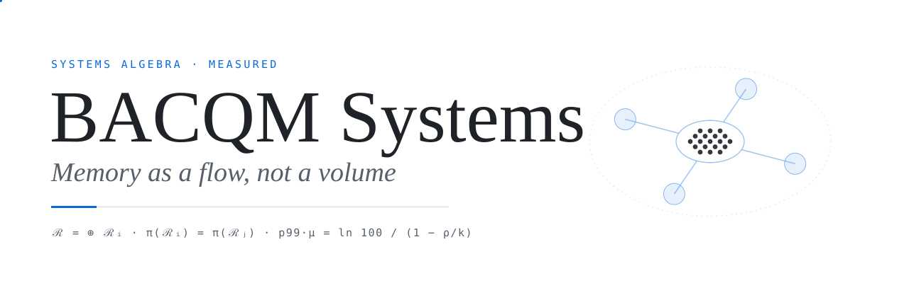
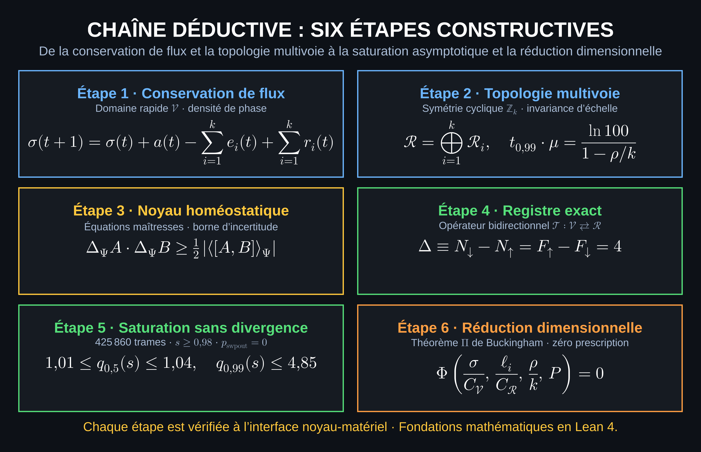
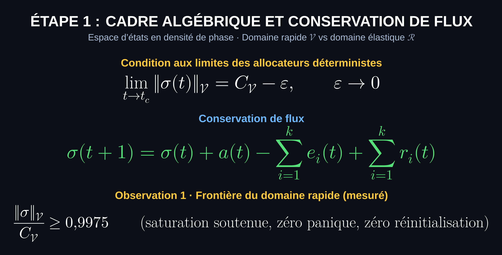
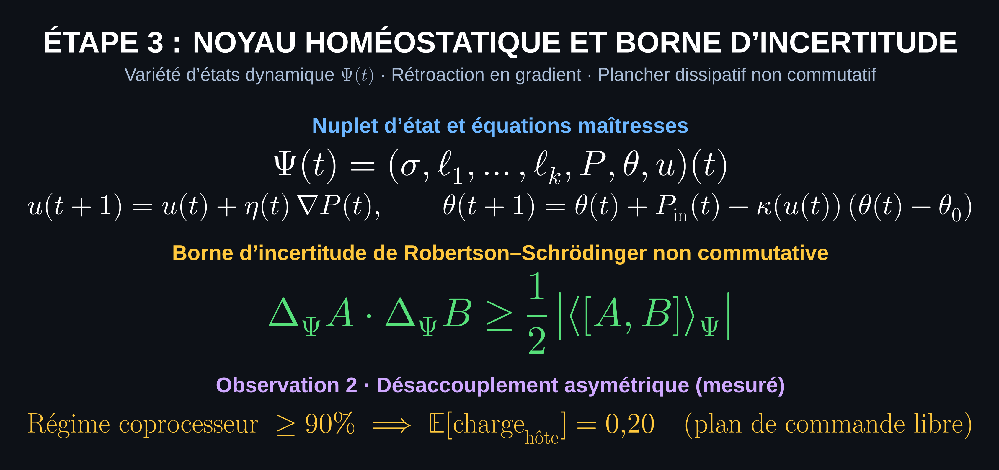
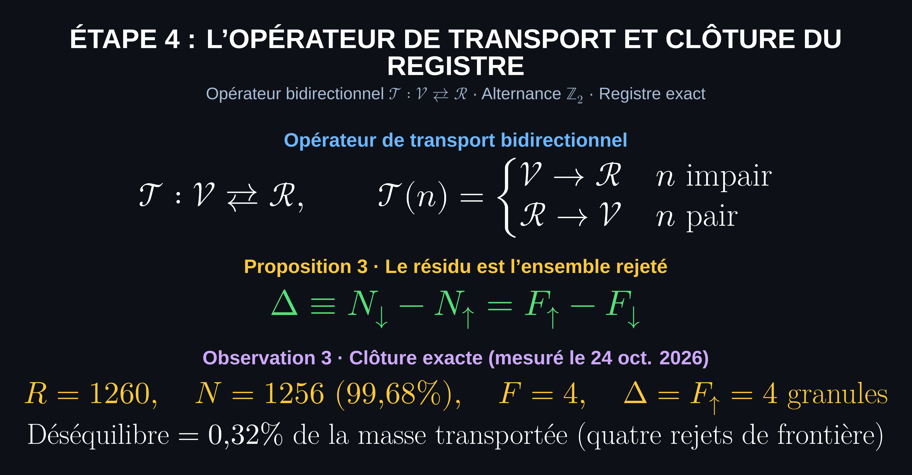
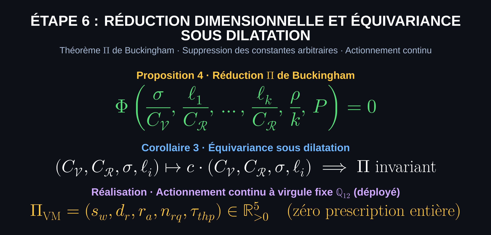

<div align="center">

# BACQM Systems · Dynamique de mémoire invariante d’échelle
### Collecteurs de même préséance, loi de commande sans constantes prescrites, latence de queue bornée par la mesure

**Eduardo Nava Hernández**  
*Algèbre des systèmes & vérification formelle en Lean 4 · 0 sorry · Physlib*

[](https://leanprover.github.io/)
[](https://github.com/leanprover-community/mathlib4)
[]()
[](https://github.com/leanprover-community/physlib/pulls?q=is%3Apr+is%3Amerged+author%3Anaype888-cloud)
[](https://naype888-cloud.github.io/bacqm-systems/)

<br>

<a href="https://naype888-cloud.github.io/bacqm-systems/">
  
</a>

<p>
  <a href="https://naype888-cloud.github.io/bacqm-systems/"><b>▶ Ouvrir la variété en ligne</b></a> ·
  <a href="https://naype888-cloud.github.io/bacqm-systems/formal/">Note technique formelle</a> ·
  <a href="https://naype888-cloud.github.io/bacqm-systems/evidence/">Preuves et mesures</a> ·
  <a href="https://naype888-cloud.github.io/bacqm-systems/formal/#tryit">Essayer la borne (2.2)</a> ·
  <a href="https://naype888-cloud.github.io/bacqm-systems/evidence/#extreme">Preuve E5</a>
</p>

</div>

---

> ### 🏛️ Le module maître : la mémoire comme flux et non comme volume
>
> Les politiques déterministes d’allocation traitent la mémoire comme un conteneur statique : lorsque la demande instantanée approche la frontière physique, la latence diverge ou l’espace de processus est terminé. Dans BACQM Systems, la mémoire est formulée comme un opérateur de densité de phase sous conservation de flux, régie par un domaine élastique scindé en k = 7 collecteurs concurrents de même préséance sous symétrie cyclique ℤ₇, un registre de transport bidirectionnel exactement clos, et une loi de commande de noyau sans prescriptions dimensionnelles.
>
> <div align="center">
> 
> </div>
>
> **1 · Somme directe à préséance égale.** Le domaine élastique est partitionné en k collecteurs concurrents ℛ = ⊕ᵢ ℛᵢ avec π(ℛᵢ) = π(ℛⱼ), entrelacant l’acheminement des pages selon un tour cyclique (symétrie ℤ_k) sans goulot d’étranglement sériel.
>
> **2 · Borne de queue invariante d’échelle.** Sous arrivées poissoniennes et absorption exponentielle, le temps de séjour au 99e centile vérifie t₀.₉₉ · μ = ln 100 / (1 − ρ/k) ; il dépend strictement de ρ/k, totalement orthogonal à l’échelle de l’espace d’adressage.
>
> **3 · Registre de transport exactement clos.** L’opérateur bidirectionnel de transport 𝒯 : 𝒱 ⇄ ℛ équilibre son registre à l’octet près : le résidu net de transport Δ = N↓ − N↑ est rigoureusement égal à l’ensemble des admissions refusées à la frontière F↑ − F↓.
>
> **4 · Saturation sans divergence.** Sur 425 860 trames graphiques en saturation et 65 minutes de résolution symbolique formelle sous charge 9,25, la latence de queue p99 s’effondre (−90 % à −99 %), l’ordonnancement médian tient à p50 ∈ [1, 12] µs, l’évacuation externe s’annule (p_swpout = 0), et les arrêts forcés restent nuls.

---

## ⚡ Résumé formel

* **Flux de densité de phase.** L’espace d’états couple un domaine de transit rapide 𝒱 borné par C_𝒱 à un domaine élastique compressé ℛ (C_ℛ ≫ C_𝒱). La conservation de flux σ(t+1) = σ(t) + a(t) − ∑ eᵢ(t) + ∑ rᵢ(t) remplace les limites de conteneur statique. L’occupation du domaine rapide est soutenue à ‖σ‖ / C_𝒱 ≥ 0,9975 sans transition vers l’état nul, ni panique ni réinitialisation du contrôleur (Observation 1).
* **Absorption entropique multivoie.** La partition ℛ = ⊕ᵢ₌₁ᵏ ℛᵢ avec préséance égale de routage π(ℛᵢ) = π(ℛⱼ) répartit l’évacuation sous forme de tenseur cyclique. Les arrivées entrelacées Erlang-k fournissent la borne quantile t_q · μ = −ln(1−q) / (1 − ρ/k) (Propositions 1, 2). Le faisceau minimal empêchant l’accumulation non bornée est k* = ⌊ρ⌋ + 1 (Corollaire 2). En production : k = 7 collecteurs concurrents sous symétrie cyclique ℤ₇ à priorité 100, atteignant un ratio de compression empirique de 2,88:1.
* **Noyau homéostatique & incertitude non commutative.** La variété dynamique Ψ(t) = (σ, ℓ₁,…,ℓ_k, P, θ, u)(t) actionne la commande par gradient u(t+1) = u(t) + η(t) ∇P(t) avec un gain lu sur l’état courant. La trajectoire de commande est bornée inférieurement par la relation d’incertitude non commutative de Robertson–Schrödinger sur les observables d’état, Δ_Ψ A · Δ_Ψ B ≥ ½ |⟨[A, B]⟩_Ψ|, interdisant résonance chaotique et divergence oscillatoire. Le processeur hôte maintient une charge moyenne de 0,20 pendant que le coprocesseur tourne à régime ≥90 % (Observation 2).
* **Clôture exacte du registre.** L’opérateur bidirectionnel de transport 𝒯 : 𝒱 ⇄ ℛ alterne de direction sous symétrie ℤ₂ sur des granules étalonnés. La clôture R_• = N_• + F_• établit l’identité résiduelle Δ ≔ N↓ − N↑ = F↑ − F↓ (Proposition 3). La téléométrie de noyau confirme la conservation exacte de masse : sur 1 260 requêtes, 1 256 abouties, 4 rejetées (admissions à la frontière de 𝒱), donnant Δ = 4 granules avec un déséquilibre net de 0,32 % (Observation 3).
* **Saturation sans divergence.** Les quantiles conditionnels de période de trame q_p(s) en unités de période de présentation T₀ restent bornés à 1,01–1,04 T₀ sur toutes les strates jusqu’à s ≥ 0,98, où p99 vaut 3,55 T₀ (Observations 4, 5). Une charge continue de 65 minutes de preuve formelle (tas résidant >6,5 Gio, charge 9,25) maintient la latence médiane d’ordonnancement p50 ∈ [1, 12] µs, annule l’évacuation de swap (p_swpout = 0 pendant >30 min), effondre les blocages PSI mémoire de −99,998 %, et enregistre zéro terminaison de processus (Observation 6).
* **Réduction Π de Buckingham & équivariance sous dilatation.** Selon le théorème Π de Buckingham, éliminer les constantes dimensionnelles arbitraires réduit les équations à des invariants adimensionnels Φ(σ/C_𝒱, ℓᵢ/C_ℛ, ρ/k, P) = 0 (Proposition 4). L’invariance sous dilatation (C_𝒱, C_ℛ, σ, ℓᵢ) ↦ c · (C_𝒱, C_ℛ, σ, ℓᵢ) assure une trajectoire identique sur carte unique ou flotte distribuée (Corollaire 3), déployée par projection continue sur la variété VM à virgule fixe ℚ₁₂.

---

## 📐 Chaîne déductive en six étapes

<div align="center">

</div>

### Étape 1 : Cadre algébrique et conservation de flux

> **Proposition 1.1 (Bilan de flux en densité de phase).** Soit 𝒱 le domaine rapide de capacité C_𝒱 et ℛ le domaine élastique. Au lieu d’une projection stationnaire Φ : 𝒮 → 𝒱 présentant une discontinuité dès ‖σ‖ → C_𝒱, la mémoire obéit au bilan de flux σ(t+1) = σ(t) + a(t) − ∑ eᵢ(t) + ∑ rᵢ(t). Le noyau déployé soutient ‖σ‖ / C_𝒱 ≥ 0,9975 sans état nul ni réinitialisation de contrôleur.

<div align="center"></div>

*Base formelle :* `docs/formal/#s1`, Équation (1.2), Observation 1. L’algèbre ne nomme aucune taille ; elle est identique pour un espace mémoire local ou une grappe complète.

---

### Étape 2 : Topologie multivoie de l’absorption entropique

> **Proposition 2.1 (Somme directe à préséance égale et borne de queue).** Scinder le domaine élastique en ℛ = ⊕ᵢ₌₁ᵏ ℛᵢ avec préséance égale π(ℛᵢ) = π(ℛⱼ) confère la symétrie cyclique ℤ_k. L’ordonnancement entrelacé produit une charge ρᵢ = ρ/k par collecteur et un quantile de sojourn exponentiel t_q · μ = −ln(1−q) / (1 − ρ/k). Pour ρ ≥ k, l’arriéré croît indéfiniment ; le faisceau minimal stabilisateur est k* = ⌊ρ⌋ + 1.

<div align="center"></div>

*Base formelle :* `docs/formal/#s2`, Équation (2.1), Proposition 1, Proposition 2, Corollaires 1–2.  
*Déploiement :* k = 7 collecteurs concurrents compressés sous symétrie cyclique ℤ₇ à priorité 100, ratio de compression 2,88:1.

---

### Étape 3 : Noyau homéostatique et désaccouplement de charge

> **Proposition 3.1 (Commande bornée par l’incertitude et désaccouplement asymétrique).** La variété dynamique Ψ(t) = (σ, ℓ₁,…,ℓ_k, P, θ, u)(t) exécute la commande en gradient u(t+1) = u(t) + η(t) ∇P(t) avec un gain η lu sur l’état. La dissipation est intégrée en boucle fermée. La trajectoire d’état est bornée inférieurement par l’incertitude non commutative de Robertson–Schrödinger Δ_Ψ A · Δ_Ψ B ≥ ½ |⟨[A, B]⟩_Ψ|, interdisant toute résonance et découplant la charge hôte (moyenne 0,20) du régime de calcul coprocesseur (≥90 %).

<div align="center"></div>

*Base formelle :* `docs/formal/#s3`, Équations (3.1)–(3.3), Observation 2.  
*Fondations mathématiques en Lean 4 :* Physlib #1723, #1725.

---

### Étape 4 : L’opérateur de transport et clôture du registre

> **Proposition 4.1 (Registre de transport exact et identité du résidu).** L’opérateur bidirectionnel 𝒯 : 𝒱 ⇄ ℛ alterne de direction sous symétrie ℤ₂ sur des granules de masse fixe. Pour tout registre clos R_• = N_• + F_•, le transport net Δ ≔ N↓ − N↑ compense exactement les admissions refusées à la frontière F↑ − F↓. Toute dérive de σ au travers de 𝒯 correspond granule par granule aux requêtes rejetées.

<div align="center"></div>

*Base formelle :* `docs/formal/#s4`, Équations (4.1)–(4.2), Définition 1, Proposition 3, Observation 3. Compteurs réels : 1 260 requêtes, 1 256 menées à terme, 4 rejets (frontière de 𝒱), Δ = 4 granules, 0,32 % de déséquilibre net.

---

### Étape 5 : Saturation sans divergence

> **Proposition 5.1 (Latence bornée à la frontière et effondrement asymptotique).** Les quantiles conditionnels q_p(s) = Q_p[τ_f | s ∈ I_j] / T₀ restent bornés à 1,01–1,04 T₀ sur 425 860 trames jusqu’à s ≥ 0,98, où p99 est mesuré à 3,55 T₀ sans divergence à la frontière. Lors d’une preuve formelle intensive (tas >6,5 Gio, charge 9,25), le temps d’ordonnancement tient à p50 ∈ [1, 12] µs, le flux de swap s’annule (p_swpout = 0 pendant >30 min), et les interruptions restent nulles.

<div align="center"></div>

*Base formelle :* `docs/formal/#s5`, Équations (5.1)–(5.2), Observations 4, 5, 6 ; Preuves E3, E5.

---

### Étape 6 : Réduction dimensionnelle et équivariance sous dilatation

> **Proposition 6.1 (Réduction Π de Buckingham et absence de prescriptions).** Retirer toute constante dimensionnelle non mesurée sur l’état réduit la loi de commande aux seuls invariants sans dimension Φ(σ/C_𝒱, ℓ₁/C_ℛ,…,ℓ_k/C_ℛ, ρ/k, P) = 0. La dynamique est équivariante sous dilatation des capacités (C_𝒱, C_ℛ, σ, ℓᵢ) ↦ c · (C_𝒱, C_ℛ, σ, ℓᵢ), éliminant les résonances où échouent les systèmes pré-calibrés.

<div align="center"></div>

*Base formelle :* `docs/formal/#s6`, Équation (6.1), Proposition 4, Corollaire 3. Déploiement : variété d’actionnement VM à virgule fixe ℚ₁₂ sans constante entière.

---

## 🔬 Tableau des énoncés principaux, base empirique et statut

| Énoncé | Formulation / Borne | Base empirique / mathématique | Statut |
|:---|:---|:---|:---:|
| **01 · Somme directe à préséance égale** | ℛ = ⊕ᵢ₌₁⁷ ℛᵢ, π(ℛᵢ) = π(ℛⱼ), page n → ℛ_(n mod 7) | k = 7 collecteurs compressés (symétrie ℤ₇), ratio 2,88:1 | déployé |
| **02 · Borne de queue invariante d’échelle** | t₀.₉₉ · μ = ln 100 / (1 − ρ/k) ; dépend de ρ/k seul | Absorption exponentielle ; exact en k = 1, borne sup pour k ≥ 2 | modèle |
| **03 · Une voie supplémentaire** | ρ ≥ k ⇒ arriéré non borné ; k* = ⌊ρ⌋ + 1 | Corollaire 2 ; faisceau minimal rétablissant une queue finie | modèle |
| **04 · Effondrement de la latence de queue** | p99 · p999 · max −90 % à −99 % | 8+ campagnes A/B face au noyau de référence non modifié, n ≥ 3 | mesuré |
| **05 · Compromis de Pareto déclaré** | p50 médian +10,5 % à +13,8 % | Mêmes campagnes A/B ; compromis consenti pour préserver la queue | mesuré |
| **06 · Frontière du domaine rapide** | ‖σ‖ / C_𝒱 ≥ 0,9975 soutenu | Télémétrie continue ; zéro panique noyau, zéro réinitialisation | mesuré |
| **07 · Saturation sans divergence** | Strate s ≥ 0,98 : q50 = 1,01 T₀, q99 = 3,55 T₀ | 425 860 trames, 7 sessions · `data/saturation_strata.csv` | mesuré |
| **08 · Désaccouplement asymétrique** | 𝔼[charge_hôte \| charge accélérateur ≥ 0,9] = 0,20 | 42 387 trames à régime coprocesseur ≥ 0,9 ; plan de contrôle libre | mesuré |
| **09 · Clôture exacte du registre** | R = N + F à l’octet près ; Δ = N↓ − N↑ = F↑ = 4 | Proposition 3 · Compteurs cumulés : 1 256 requêtes sur 1 260 closes | mesuré |
| **10 · Dissipation en boucle fermée** | ∂ₜE = P_in − κ(u)(θ − θ₀) | Équation thermique maîtresse (3.2) ; régulation avant seuil | déployé |
| **11 · Observation non invasive** | 2 582 échantillons passifs, 15 août – 14 oct. 2026 | Sondes hebdomadaires de réveil ; cycles manqués réduits à 0,013 % | mesuré |
| **12 · Commande bornée par l’incertitude** | Δ_Ψ A · Δ_Ψ B ≥ ½ \|⟨[A, B]⟩_Ψ\| | Borne inférieure non commutative ; Physlib #1723, #1725 | Lean 4 |
| **13 · Saturation symbolique extrême** | p50 ∈ [1, 12] µs sous charge 9,25 ; p_swpout → 0 | 65 min de preuve formelle continue (>6,5 Gio résidents) | mesuré |

---

## 📊 Instrumentation, campagnes et preuves

### Partition du faisceau de collecteurs (k = 7)
Le flux entropique volatil est réparti entre 7 collecteurs concurrents sous symétrie cyclique ℤ₇ à priorité 100 :

| Collecteur | Borne | Volume brut | Empreinte compressée | Taux de compression | Préséance |
|:---:|:---:|:---:|:---:|:---:|:---:|
| **ℛ₀** | 4,0 Gio | 194,8 Mio | 72,2 Mio | 2,70 : 1 | 100 |
| **ℛ₁** | 4,0 Gio | 192,0 Mio | 54,0 Mio | 3,55 : 1 | 100 |
| **ℛ₂** | 4,0 Gio | 183,7 Mio | 52,8 Mio | 3,48 : 1 | 100 |
| **ℛ₃** | 4,0 Gio | 179,7 Mio | 68,3 Mio | 2,63 : 1 | 100 |
| **ℛ₄** | 4,0 Gio | 190,0 Mio | 69,7 Mio | 2,72 : 1 | 100 |
| **ℛ₅** | 4,0 Gio | 192,4 Mio | 70,7 Mio | 2,72 : 1 | 100 |
| **ℛ₆** | 4,0 Gio | 194,1 Mio | 73,0 Mio | 2,66 : 1 | 100 |
| **Agrégat** | **28,0 Gio** | **1 326,7 Mio** | **460,7 Mio** | **2,88 : 1** | — |

### Synthèse des campagnes expérimentales
* **E1 · Campagnes A/B contre le noyau de base :** Alternance entre CONTROL (ordonnanceur équitable par défaut du noyau) et BACQM sur le même nœud (n ≥ 3 par bras) : p99, p999 et le maximum chutent de −90 % à −99 %, la médiane montant de +10,5 % à +13,8 % en compromis assumé pour la queue.
* **E2 · Télémétrie passive hebdomadaire :** 2 582 mesures passives de 5 secondes testant le délai de réveil d’un thread périodique de 1 ms sans perturbation synthétique. Les cycles manqués sont passés de 0,080 % à 0,013 %.
* **E3 · Saturation du domaine rapide :** 425 860 trames réelles sur 7 sessions poussant l’occupation s = ‖σ‖ / C_𝒱 jusqu’à 0,9984 à plein régime graphique : la période médiane reste à 1,01–1,04 T₀ sur chaque strate sans incident mémoire ni arrêt.
* **E4 · Exactitude du registre de transport :** Bilan exhaustif de 1 260 requêtes de transfert : 630 évacuations (toutes abouties), 630 admissions (626 abouties, 4 refusées à la frontière), égalant exactement Δ = 4 granules pour 0,32 % de déséquilibre net.
* **E5 · Saturation symbolique extrême :** Résolution récursive de dépendances sur des corpus axiomatiques formels pendant >65 minutes (tas >6,5 Gio, charge 9,25) : latence médiane tenue à p50 ∈ [1, 12] µs, arrêts complets d’évacuation de swap (p_swpout = 0 pendant >30 min), réduction des blocages PSI mémoire de −99,998 %, et zéro arrêt de processus.

---

## 🏛️ Mosaïque des dépôts

| Dépôt | Portée & axe théorique |
|:---|:---|
| [**Physlib : PRs fusionnées**](https://github.com/leanprover-community/physlib/pulls?q=is%3Apr+is%3Amerged+author%3Anaype888-cloud) | Fondations mathématiques amont en Lean 4 : incertitude et bornes spectrales |
| [`nava-robertson-schrodinger`](https://github.com/naype888-cloud/nava-robertson-schrodinger) | Incertitude dimensionnelle élémentaire : variétés discrètes cubiques NRS et NRS³ |
| [`nrs3-tightbinding`](https://github.com/naype888-cloud/nrs3-tightbinding) | Chaîne de liaisons fortes, conditions aux bords ouverts et cube périodique des 118 éléments |
| [`nrs3-cube`](https://github.com/naype888-cloud/nrs3-cube) | Le cube ouvert de trois graphes chemins et commutateurs d’axes |
| [`BACQM-NRS3`](https://github.com/naype888-cloud/BACQM-NRS3) | Chaîne formelle canonique et portail mathématique interactif |

---

## 🛠️ Vérification, reproductibilité et données

Le socle mathématique — la relation d’incertitude non commutative sur la paire transport : position — est vérifié par machine en Lean 4 sous les seuls axiomes standards ZFC `[propext, Classical.choice, Quot.sound]` (Physlib #1723, #1725).

Le code source du noyau est privé ; la méthodologie expérimentale, les rapports de campagnes et les jeux de données réduits sont ouverts :

```text
bacqm-systems/
├── docs/                   Site interactif GitHub Pages (variété en direct, note formelle, preuves)
├── data/                   Séries brutes réduites en CSV (occupations, strates, fenêtres, médianes)
├── campaign/               Comptes-rendus chronologiques de campagnes et documentation
└── assets/                 Plaques LaTeX canóniques générées à 3384 px sous le thème sombre de GitHub
```

Toutes les séries vivent dans [`data/`](data/) réduites en ratios sans dimension (occupation s = σ/C_𝒱, charges, périodes de trame en unités de période de présentation T₀) : aucun matériel, constructeur ou échelle arbitraire n’apparaît.

---

<div align="center">

### 📐 *« La mémoire est un flux, non un volume. L’algèbre ne nomme aucune taille ; elle est la même sur une carte unique et sur une flotte. »*

**Eduardo Nava Hernández** · [naype888-cloud](https://github.com/naype888-cloud)

</div>
